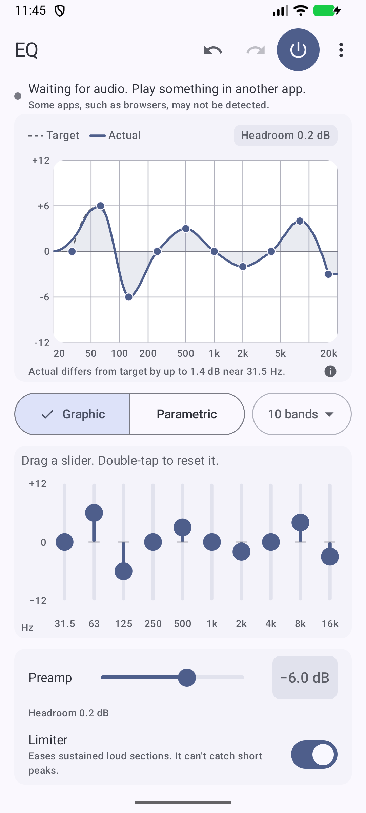
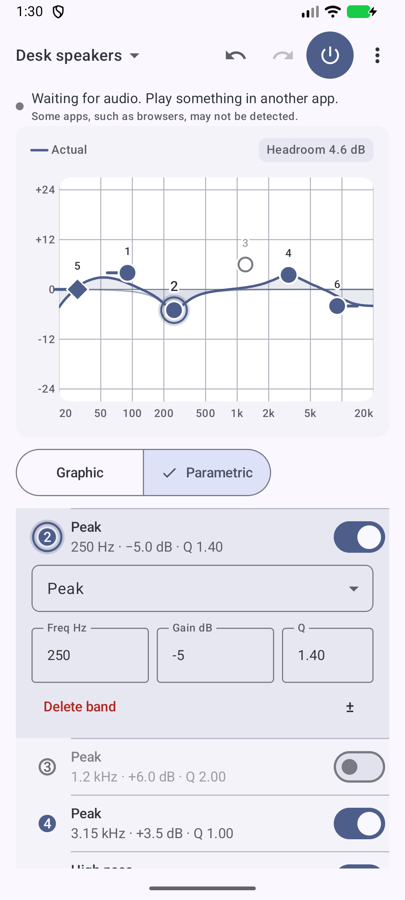
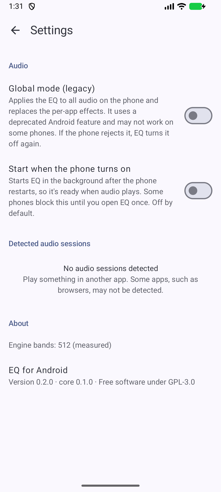

<div align="center">


# EQ for Android

**A system-wide equalizer for other apps' audio on a stock Android phone.**

Download the APK from the project's GitHub Releases page (not published yet, see [docs/RELEASING.md](docs/RELEASING.md)). Android 9 or later (minSdk 28). arm64-v8a, armeabi-v7a and x86_64.

<picture>
  <source media="(prefers-color-scheme: dark)" srcset="docs/screenshot-graphic-dark.png">
  
</picture>

</div>

EQ shapes the sound of other apps with Android's `DynamicsProcessing` audio effect. You draw a curve, and the effect is attached to the audio sessions of the apps that announce one. It needs no root, no account and no network access.

It has a graphic mode (5, 10, 15 or 31 bands, plus or minus 12 dB per slider) and a parametric mode (up to 16 bands: peak, low shelf, high shelf, low pass and high pass, with frequency, gain up to plus or minus 24 dB, and Q). Both modes share a preamp (down to -24 dB) and a limiter.

<div align="center">

<picture>
  <source media="(prefers-color-scheme: dark)" srcset="docs/screenshot-parametric-dark.png">
  
</picture>


</div>

The screenshots come from an Android 17 arm64 emulator, not from a phone.

## Features

- Graphic mode with 5, 10, 15 or 31 bands, and parametric mode with up to 16 bands. Drag the nodes on the curve, or type exact frequency, gain and Q values.
- A preamp, with a suggested value when the curve would push the output over full scale, and a limiter that is on by default. The limiter eases sustained loud sections; it cannot catch short peaks.
- Undo and redo.
- A bypass switch in the app and in the notification.
- Your settings are saved and restored.
- An optional "Start when the phone turns on" setting (off by default).
- Light and dark themes, and Material You dynamic colour on Android 12 or later.
- A Settings screen that lists the audio sessions it has detected.

There are no presets, per-device EQs or AutoEq imports in this version.

## Install

1. Download `EQ-0.1.0.apk` from the Releases page once it is published.
2. Open it on your phone. Android asks you to allow installs from your browser or file manager ("unknown sources"). Play Protect may also show a notice about an app it has not seen before.
3. Or install it from a computer with `adb install EQ-0.1.0.apk`.

The APK is signed with the author's own key. `scripts/release-apk.sh` prints the signing certificate fingerprint when it builds the APK; to check a downloaded APK, run `apksigner verify --print-certs` and compare the SHA-256 digest with the fingerprint the author publishes with the release.

## First run

1. Open EQ and allow notifications. EQ runs as a foreground service so it can stay attached, and the notification is where the bypass switch lives.
2. Play audio in another app. EQ attaches to apps that announce an audio session and shows them under Detected audio sessions in Settings.
3. If an app is not detected, turn on "Global mode (legacy)" in Settings. It applies the EQ to all audio on the phone and replaces the per-app effects. It uses a deprecated Android feature and may not work on some phones; if the phone rejects it, EQ turns it off again.

## How it works

A Rust core (`core/`, crate `eq-core`) holds the band model, converts your curve into gains on a fixed grid of about 300 bands, and checks the result against a model of the Android effect. The Kotlin and Jetpack Compose app (`app/`) draws the interface and runs the service that attaches `DynamicsProcessing` to each audio session. The two are joined with UniFFI and built with cargo-ndk.

The effect works on blocks of audio. EQ uses an 85.3 ms block so that narrow filters are accurate, which is also where the added delay comes from.

## Limits and what is not verified

Everything here was checked on one Android 17 arm64 emulator only. Nothing has been tested on a physical phone, and no real player (Spotify, YouTube and so on) has been tested. The list below says what is known to be off and what has never been tried.

Known limits:

- About 85 ms of delay is added to the audio. This may be noticeable against video.
- Narrow low-frequency filters are approximate. The effect applies one gain across each block of frequencies, so a narrow peak at 100 Hz can be several dB off (the model gives about 5.7 dB for Q 8), a peak at 200 Hz up to about 1.4 dB, and broad peaks at 50 Hz up to about 0.8 dB. From 500 Hz up the error stays at or below about 0.6 dB for Q 8 and under. These numbers come from a model of the effect that was checked against measurements on the emulator, not from measuring the delivered response of every setting.
- The curve view draws two lines: the Target you designed and the Actual response EQ expects the effect to deliver, computed from that model. The Actual line was not checked against measured output on a phone.
- Apps that do not announce an audio session are only reached by global mode, which may not work on some phones.
- The limiter was checked against Android's reference audio library only. Phone makers' own audio libraries may behave differently.
- There is one undo history shared by both modes. After you switch modes, Undo can revert a change made in the other mode with no visible change on the screen you are looking at.
- The numeric keyboard has no "k", so type frequencies in Hz (for example 1500, not 1.5k). A comma is always read as a decimal separator.
- Reset all in Parametric restores the default seven bands. "Remove all bands" empties the list.
- The node long-press menu closes when you rotate the phone.
- The APK is not minified and is about 25 MB. See [docs/MINIFICATION.md](docs/MINIFICATION.md).
- One service crash was seen once, about a second after Android restarted the service following a `kill -9`, and it could not be reproduced or explained in about 170 test restarts. It is not claimed fixed.

Never tried (not verified, none marked as passed):

- Any physical phone: sound, battery use, background limits set by phone makers, restart behaviour, and whether the notification appears when you deny the notification permission.
- Real players: whether they announce an audio session, and when.
- Global mode: whether it is audible, and whether real phones accept it.
- Start on boot after a real restart, including a phone with a lock screen set.
- Changing the output (Bluetooth, headphones) or the sample rate while playing.
- The themed (monochrome) app icon, TalkBack, the reduced-motion setting, dynamic colour with real wallpapers, touch and haptic feel, and different keyboards.
- Devices on Android 9 to 11 (the fallback colours were checked in code only).
- The release workflow in `.github/workflows/release.yml` has never run (see Releasing below), and a build signed with a real release key has not been made.

## Privacy

EQ declares no network permission. The merged manifest of the built release APK was checked with `aapt2 dump permissions` and does not contain `android.permission.INTERNET`. The permissions it does request are:

- `MODIFY_AUDIO_SETTINGS`: needed to attach the effect to the global output mix in global mode.
- `FOREGROUND_SERVICE` and `FOREGROUND_SERVICE_SPECIAL_USE`: to keep the equalizer service running.
- `POST_NOTIFICATIONS`: to show the service notification (Android 13 and later).
- `RECEIVE_BOOT_COMPLETED`: for the optional start on boot setting.

It does not request `RECORD_AUDIO`, and it does not read or store your audio. Your settings stay in the app's own storage on the phone.

## Build from source

You need JDK 25, the Android SDK 37 with build-tools 36.0.0, NDK 27.1.12297006, Rust (stable) with the Android targets `aarch64-linux-android`, `armv7-linux-androideabi` and `x86_64-linux-android`, and cargo-ndk.

```bash
cargo test --workspace
```

```bash
./gradlew :app:assembleDebug
```

A test-signed APK, named `EQ-0.1.0-TESTSIGNED.apk`, that must never be published:

```bash
scripts/release-apk.sh --test
```

A real release needs your own keystore. Create one with `scripts/create-keystore.sh`, then run `scripts/release-apk.sh` with no argument. The script builds, signs and checks the APK (signature, 16 KB alignment, no debug code).

`playerstub/` is test tooling that imitates a player's audio-session broadcasts. It is not part of the app.

### Releasing

The steps to publish are in [docs/RELEASING.md](docs/RELEASING.md). The GitHub workflow in `.github/workflows/release.yml` has never run. It was checked statically only, and it creates a draft release.

## License

GPL-3.0. See [LICENSE](LICENSE).
