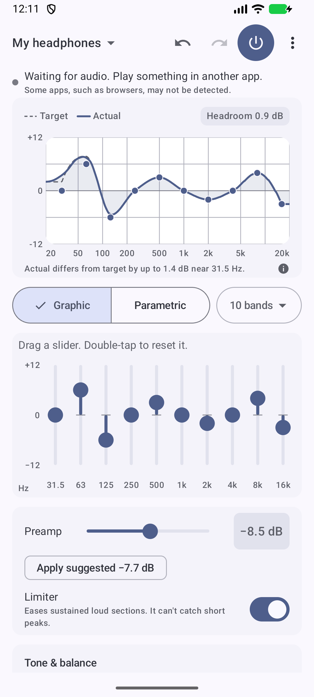
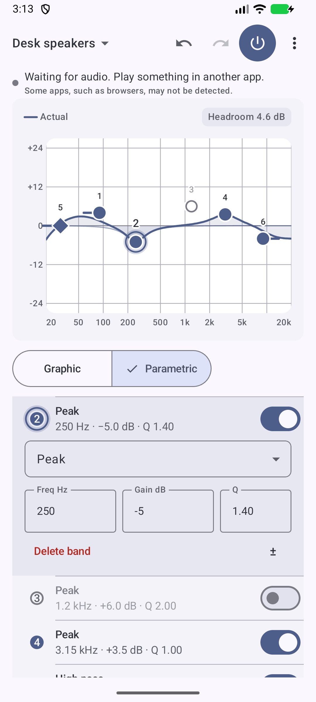
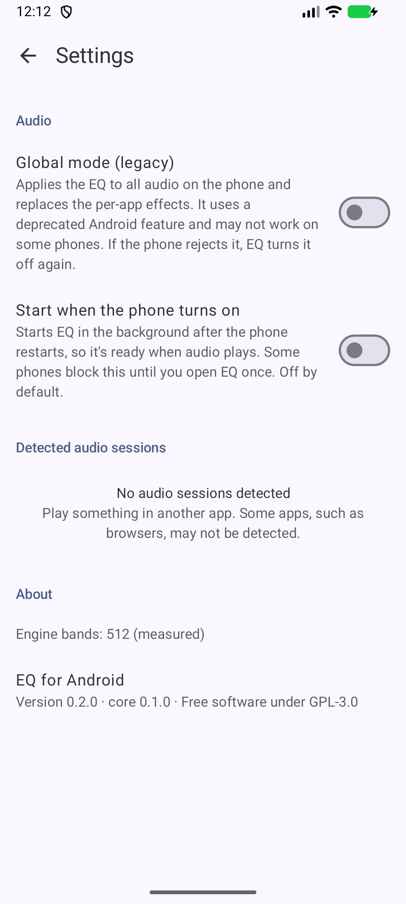
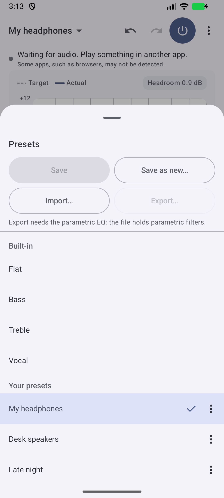
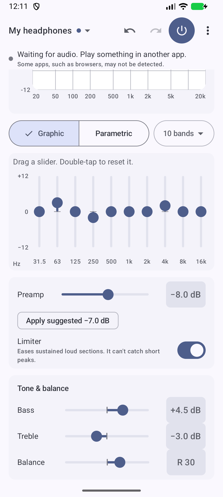
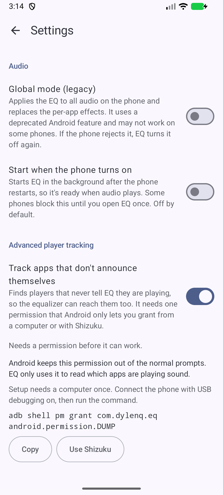
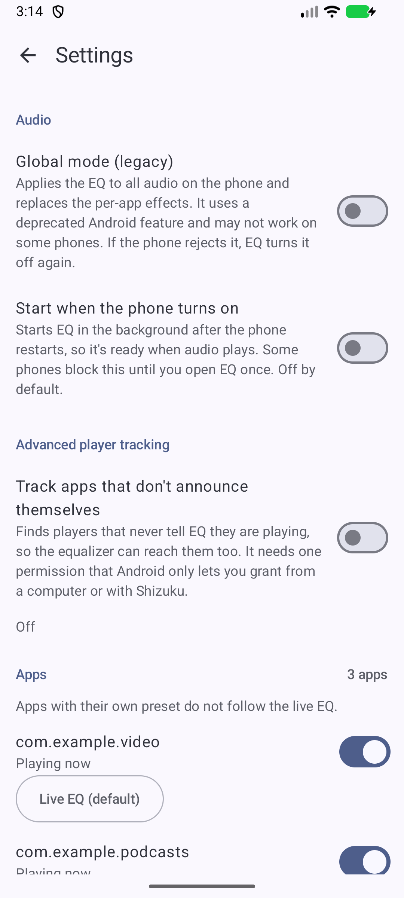

<div align="center">


# EQ for Android

**A system-wide equalizer for other apps' audio on a stock Android phone.**

Download the APK from the [Releases page](https://github.com/dylenq/android-parametric-eq/releases/latest). Android 9 or later (minSdk 28). arm64-v8a, armeabi-v7a and x86_64.

<picture>
  <source media="(prefers-color-scheme: dark)" srcset="docs/screenshot-graphic-dark.png">
  
</picture>

</div>

EQ shapes the sound of other apps with Android's `DynamicsProcessing` audio effect. You draw a curve, and the effect is attached to the audio sessions of the apps that announce one. An optional setting also reaches players that never announce. It needs no root, no account and no network access.

It has a graphic mode (5, 10, 15 or 31 bands, plus or minus 12 dB per slider) and a parametric mode (up to 16 bands: peak, low shelf, high shelf, low pass and high pass, with frequency, gain up to plus or minus 24 dB, and Q). Both modes share a preamp (down to -24 dB), a limiter, bass and treble controls, a left/right balance, and named presets.

<div align="center">

<picture>
  <source media="(prefers-color-scheme: dark)" srcset="docs/screenshot-parametric-dark.png">
  
</picture>


</div>

<div align="center">




</div>

<div align="center">




</div>

The screenshots come from an Android 17 arm64 emulator. `spike-tools/readme-screens.sh` retakes them.

## Features

- Graphic mode with 5, 10, 15 or 31 bands, and parametric mode with up to 16 bands. Drag the nodes on the curve, or type exact frequency, gain and Q values.
- A preamp, with a suggested value when the curve would push the output over full scale, and a limiter that is on by default. The limiter eases sustained loud sections; it cannot catch short peaks.
- Named presets. Save the whole sound (mode, graphic gains or parametric bands, preamp, bass, treble and balance) under a name, and apply it again later. Four built-in presets (Flat, Bass, Treble and Vocal) cannot be edited; you can rename and delete your own. The title bar shows the active preset, with an "Edited" marker once you change the sound. Applying a preset is one undo step. Import and Export in the preset list read and write AutoEq files: Import accepts a ParametricEQ.txt (filters become parametric bands) or a GraphicEQ.txt (the curve is fitted to your current graphic band count) and saves it as a new preset without overwriting any existing one; Export saves the live parametric EQ as a ParametricEQ.txt. Bass, treble and balance are not part of these files, and Export needs the parametric EQ.
- Bass and treble shelf controls (plus or minus 12 dB) and a left/right balance control. Balance only turns the opposite channel down, down to a floor of -60 dB.
- Undo and redo.
- At start, EQ asks the phone how many bands its audio effect accepts and fits the curve to that grid, and it retries when attaching the effect fails for a moment.
- A bypass switch in the app and in the notification.
- Your settings are saved and restored.
- An optional "Start when the phone turns on" setting (off by default).
- Light and dark themes, and Material You dynamic colour on Android 12 or later.
- A Settings screen that lists the audio sessions it has detected.
- Per-app control. The Apps section in Settings lists the apps EQ has seen. Turn EQ off for an app, or give it a preset of its own so it does not follow the live EQ. Global mode ignores these settings.
- Device presets. The Output devices section in Settings lists the outputs EQ has seen (phone speaker, wired headphones, Bluetooth, USB). Give one a preset and it is applied to the live EQ when you switch to that output; you can still edit it afterwards. A device with no preset keeps the current sound.
- A Quick Settings tile. Add the EQ tile from the Quick Settings edit screen to turn EQ on or off with one tap.
- Advanced player tracking (optional, off by default). It reaches players that never announce an audio session, without using global mode. See [Tracking players that do not announce](#tracking-players-that-do-not-announce).

## Install

1. Download `EQ-0.3.0-TESTSIGNED.apk` from the Releases page.
2. Open it on your phone. Android asks you to allow installs from your browser or file manager ("unknown sources"). Play Protect may also show a notice about an app it has not seen before.
3. Or install it from a computer with `adb install EQ-0.3.0-TESTSIGNED.apk`.

Release 0.3.0 is signed with the project's test key, not a private release key. Anyone who builds the project can sign with that key, so only download it from this repository's Releases page. A later release signed with a private key will not install over it: uninstall first, which deletes saved settings and presets. To check a downloaded APK, run `apksigner verify --print-certs` and compare the SHA-256 digest with the fingerprint published with the release.

## First run

1. Open EQ and allow notifications. EQ runs as a foreground service so it can stay attached, and the notification is where the bypass switch lives.
2. Play audio in another app. EQ attaches to apps that announce an audio session and shows them under Detected audio sessions in Settings.
3. If an app is not detected, turn on "Global mode (legacy)" in Settings. It applies the EQ to all audio on the phone and replaces the per-app effects. It uses a deprecated Android feature and may not work on some phones; if the phone rejects it, EQ turns it off again. Advanced player tracking, below, is the other way to reach such an app.

## Tracking players that do not announce

Some players never tell the system they are playing, so EQ cannot see them. With "Track apps that don't announce themselves" on, EQ checks which apps are playing whenever playback changes, and attaches to the ones it finds.

This needs the `DUMP` permission, which Android only lets you grant from a computer or with Shizuku. You do it once:

- **From a computer:** turn on USB debugging, connect the phone and run the command that Settings shows, which you can copy:

  ```bash
  adb shell pm grant com.dylenq.eq android.permission.DUMP
  ```

- **With Shizuku:** if the Shizuku app is installed and running, tap "Use Shizuku" in Settings. EQ tells you if Shizuku is missing, not running or refuses.

Settings shows the state at all times: off, needs a permission, working, reboot once, or not supported on this phone. No restart is needed after the grant. "Reboot the phone once" means the audio server remembered an earlier refusal; EQ never asks it before the permission is granted, so this should be rare. Apps that announce themselves keep working in every state. Android 9 should report not supported, because its session table is believed to have no user id; no Android 9 device was available to confirm it.

## How it works

A Rust core (`core/`, crate `eq-core`) holds the band model, converts your curve into gains on a fixed grid of about 300 bands, and checks the result against a model of the Android effect. The Kotlin and Jetpack Compose app (`app/`) draws the interface and runs the service that attaches `DynamicsProcessing` to each audio session. The two are joined with UniFFI and built with cargo-ndk.

The effect works on blocks of audio. EQ uses an 85.3 ms block so that narrow filters are accurate, which is also where the added delay comes from.

## Limits and what is not verified

The checks below ran on one Android 17 arm64 emulator. The author has also installed 0.2.0 on one phone and used it without problems, but 0.3.0 has not been on a physical phone, no structured tests were run on one, and no real player (Spotify, YouTube and so on) has been tested systematically. The list below says what is known to be off and what has not been checked.

Known limits:

- About 85 ms of delay is added to the audio. This may be noticeable against video.
- Narrow low-frequency filters are approximate. The effect applies one gain across each block of frequencies, so a narrow peak at 100 Hz can be several dB off (the model gives about 5.7 dB for Q 8), a peak at 200 Hz up to about 1.4 dB, and broad peaks at 50 Hz up to about 0.8 dB. From 500 Hz up the error stays at or below about 0.6 dB for Q 8 and under. These numbers come from a model of the effect that was checked against measurements on the emulator, not from measuring the delivered response of every setting.
- The curve view draws two lines: the Target you designed and the Actual response EQ expects the effect to deliver, computed from that model. The Actual line was not checked against measured output on a phone.
- Apps that do not announce an audio session are only reached by advanced player tracking, which needs a one-time grant, or by global mode, which may not work on some phones.
- Tracking reads the audio server's session table through a hidden Android interface. A future Android version or a phone maker's build could block it or change the format. EQ then reports "not supported" and carries on with the apps that announce.
- Revoking the permission may not stop the audio server accepting the request until it restarts. EQ checks the permission itself and stops reading when it is gone.
- A per-app preset does not follow the live EQ, and global mode ignores per-app settings because it is one effect on the whole output.
- Two identical Bluetooth devices count as one output, so they share a device preset. Leaving a device that has a preset does not bring back the previous sound.
- AutoEq files must be UTF-8 text. Tone and balance are not saved in an exported file, and Export needs the parametric EQ.
- The limiter was checked against Android's reference audio library only. Phone makers' own audio libraries may behave differently.
- There is one undo history shared by both modes. After you switch modes, Undo can revert a change made in the other mode with no visible change on the screen you are looking at.
- The numeric keyboard has no "k", so type frequencies in Hz (for example 1500, not 1.5k). A comma is always read as a decimal separator.
- Reset all in Parametric restores the default seven bands. "Remove all bands" empties the list.
- The node long-press menu closes when you rotate the phone.
- Presets, bass and treble, balance and the band-count probe were checked on the emulator only. The emulator accepted the largest grid the probe tries (512 bands), so the smaller-grid fit was exercised with a forced test setting, not on a phone that needs it. Balance was measured on the emulator with test tones, not heard on a phone.
- A state file saved with presets and then opened by an older build drops the presets the next time that build saves.
- The APK is not minified and is about 25 MB. See [docs/MINIFICATION.md](docs/MINIFICATION.md).
- One service crash was seen once, about a second after Android restarted the service following a `kill -9`, and it could not be reproduced or explained in about 170 test restarts. It is not claimed fixed.

Not checked (none marked as passed):

- Physical phones beyond the author's own everyday use: measured sound, battery use, background limits set by phone makers, restart behaviour, and whether the notification appears when you deny the notification permission.
- Real players: whether they announce an audio session, and when. Tracking was checked with a small stub player that sends no announcement, not with a real player.
- A real Shizuku server. The in-app flow ran against a fake, and the command it sends was run with `adb shell`.
- The "reboot once" state against a real refusal, tracking on Android versions other than 17, and session tables on phone makers' builds.
- How per-app and device presets sound. The emulator has no audio output, so the parameters sent were checked, not the sound.
- Device presets with real headphones, Bluetooth or USB. These ran through a fake output source; only the emulator's speaker was seen for real.
- The system file picker for AutoEq import and export, and files from cloud storage. Tests used the same file streams without the picker.
- Real AutoEq downloads. The files tested have the same shape but were written for the tests.
- The look of the Quick Settings tile in a real phone's panel. Tile clicks were checked on the emulator.
- Global mode: whether it is audible, and whether real phones accept it.
- Start on boot after a real restart, including a phone with a lock screen set.
- Changing the output (Bluetooth, headphones) or the sample rate while playing. EQ re-applies the curve when the list of outputs changes, but that has not been tried with real hardware.
- The themed (monochrome) app icon, TalkBack, the reduced-motion setting, dynamic colour with real wallpapers, touch and haptic feel, and different keyboards.
- Devices on Android 9 to 11 (the fallback colours were checked in code only).
- The release workflow in `.github/workflows/release.yml` has never completed a run (see Releasing below), and a build signed with a real release key has not been made.

## Privacy

EQ declares no network permission. The merged manifest of the built release APK was checked with `aapt2 dump permissions` and does not contain `android.permission.INTERNET`. The permissions it does request are:

- `MODIFY_AUDIO_SETTINGS`: needed to attach the effect to the global output mix in global mode.
- `FOREGROUND_SERVICE` and `FOREGROUND_SERVICE_SPECIAL_USE`: to keep the equalizer service running.
- `POST_NOTIFICATIONS`: to show the service notification (Android 13 and later).
- `RECEIVE_BOOT_COMPLETED`: for the optional start on boot setting.
- `DUMP`: only for advanced player tracking, and only once you grant it yourself. Android does not grant it on install. With it, EQ asks the audio server for its status report and uses only the table of audio sessions: session number, process, user id and app name. That report is read in memory, is not saved or sent anywhere, and is never requested unless the setting is on and the permission is granted.

The Shizuku library is included for the optional grant. EQ only ever asks Shizuku to run that one grant command for its own package.

It does not request `RECORD_AUDIO`, and it does not read or store your audio. Your settings, including the list of apps and output devices EQ has seen, stay in the app's own storage on the phone.

## Build from source

### Project layout

| Path | What it is |
| --- | --- |
| `core/` | Rust crate `eq-core`: bands, presets, undo, curve fitting and state files. No Android dependencies. |
| `uniffi-bindgen/` | Generates the Kotlin bindings for the core. |
| `app/` | The Kotlin and Jetpack Compose app: `service/` attaches the effects, `ui/` draws the screens. |
| `playerstub/` | Test tooling that imitates a player's audio-session broadcasts. Not part of the app. |
| `scripts/` | Release, keystore and docs checks. |
| `spike-tools/` | Emulator scripts: soak tests and the README screenshots. |

### Prerequisites

| Tool | Version |
| --- | --- |
| JDK | 25 (Android Studio's bundled runtime works) |
| Android SDK | platform 37, build-tools 36.0.0 |
| Android NDK | 27.1.12297006 |
| Rust | stable, with targets `aarch64-linux-android`, `armv7-linux-androideabi` and `x86_64-linux-android` |
| cargo-ndk | 4.1.2 |

Gradle fetches the rest. The main dependencies are Jetpack Compose and Material 3, Kotlin coroutines, UniFFI and JNA for the bridge to Rust, serde for the state file, and Shizuku-API (MIT) for the optional one-tap permission grant. Versions are pinned in [app/build.gradle.kts](app/build.gradle.kts) and [core/Cargo.toml](core/Cargo.toml).

### Build and test

```bash
cargo test --workspace
```

```bash
./gradlew :app:testDebugUnitTest
```

```bash
./gradlew :app:assembleDebug
```

The instrumented tests need a running emulator or a connected device:

```bash
./gradlew :app:connectedDebugAndroidTest
```

The first Gradle build compiles the Rust core for all three ABIs and generates the bindings.

CI ([.github/workflows/ci.yml](.github/workflows/ci.yml)) runs clippy, the Rust tests, the unit tests and the debug build on every pull request. It has not run yet. It skips the instrumented tests, which need an emulator with working audio effects.

No toolchain? The [Dockerfile](Dockerfile) is a build environment that runs the same checks and builds the debug APK. It has not been built yet, because the development machine has no Docker. The app is an APK with no server side, so there is no hosting configuration such as `vercel.json`.

```bash
docker build -t eq-android-build .
```

```bash
docker run --rm -v "$PWD:/src" eq-android-build
```

### Environment variables

The app itself reads none at runtime. These affect the build only, and none is needed for a debug build when the SDK is in the default location.

| Variable | Used by | Purpose |
| --- | --- | --- |
| `JAVA_HOME` | Gradle, scripts | The JDK. `spike-tools/env.sh` sets it to Android Studio's runtime on macOS. |
| `ANDROID_HOME` | Gradle, scripts | The Android SDK. Can also be `sdk.dir` in `local.properties`. |
| `EQ_KEYSTORE_FILE` | Release build | Path to the release keystore. |
| `EQ_KEYSTORE_PASSWORD` | Release build | Keystore password. |
| `EQ_KEY_ALIAS` | Release build | Key alias. |
| `EQ_KEY_PASSWORD` | Release build | Key password. Optional, defaults to the keystore password. |
| `EQ_OFFLINE` | `scripts/release-apk.sh` | `1` passes `--offline` to Gradle. |
| `EQ_BUILD_TOOLS` | `scripts/release-apk.sh` | Overrides the build-tools directory. |

Instead of the four `EQ_KEY*` variables you can use a git-ignored `keystore.properties`. See [keystore.properties.example](keystore.properties.example).

### Release builds

A test-signed APK, named `EQ-<version>-TESTSIGNED.apk`:

```bash
scripts/release-apk.sh --test
```

A real release needs your own keystore. Create one with `scripts/create-keystore.sh`, then run `scripts/release-apk.sh` with no argument. The script builds, signs and checks the APK (signature, 16 KB alignment, no debug code).

### Releasing

The steps to publish are in [docs/RELEASING.md](docs/RELEASING.md). The GitHub workflow in `.github/workflows/release.yml` has never completed a run: it needs the release-key secrets, which are not set up yet. Release 0.2.0 was published by hand with the test-signed APK. When it does run, the workflow creates a draft release.

## License

GPL-3.0. See [LICENSE](LICENSE).
